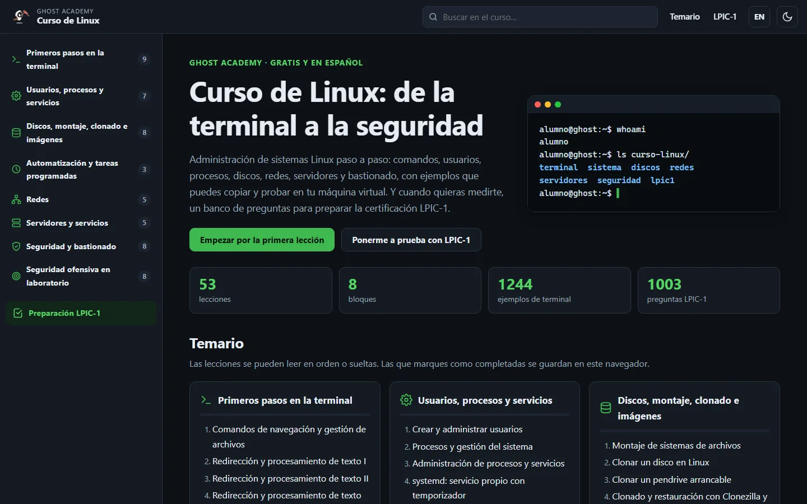
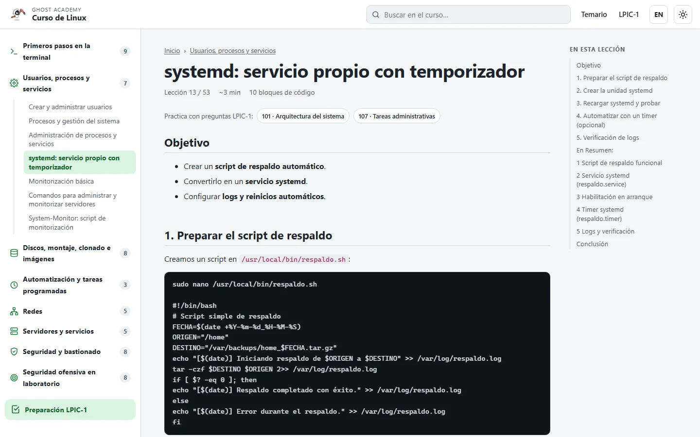
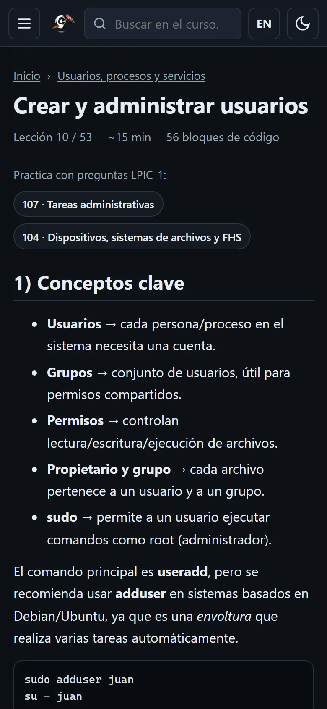
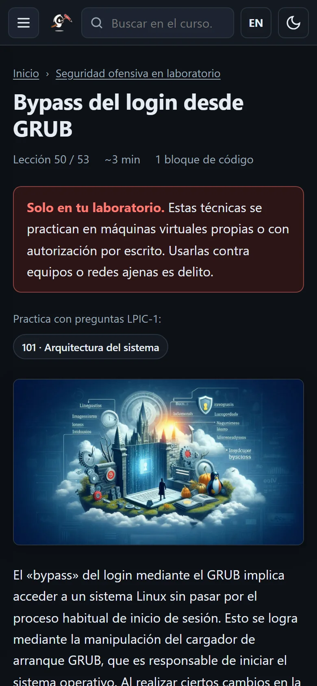
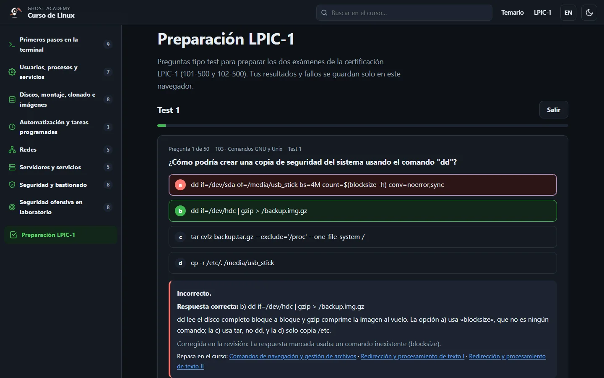
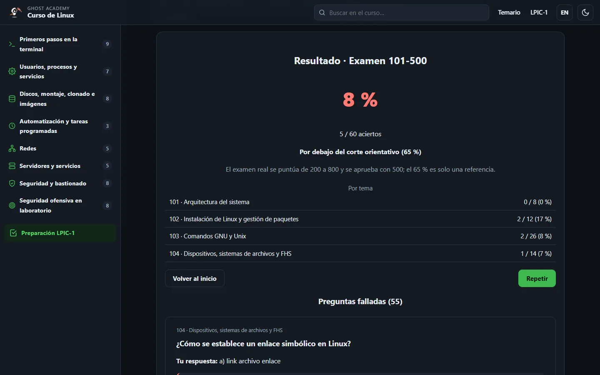

<p align="center">
  <a href="https://www.unfantasmaenelsistema.com"></a>
</p>

<h1 align="center">Curso de Linux</h1>

<p align="center">
  <b>De la terminal a la seguridad, en español y gratis</b><br>
  53 lecciones prácticas · 1.244 ejemplos de terminal · 1.003 preguntas para preparar LPIC-1
</p>

<p align="center">
  <a href="https://unfantasmaenelsistema.github.io/Curso-Linux/"><b>▶ Abrir el curso</b></a> ·
  <a href="https://unfantasmaenelsistema.github.io/Curso-Linux/lpic1/"><b>Preparación LPIC-1</b></a> ·
  <a href="#temario">Temario</a> ·
  <a href="#preparación-lpic-1">LPIC-1</a> ·
  <a href="#cómo-está-hecho">Cómo está hecho</a> ·
  <a href="https://www.ghostacademy.unfantasmaenelsistema.com/">Ghost Academy</a> ·
  <a href="LICENSE">MIT</a>
</p>

<p align="center">
  
  
  
  
</p>

<p align="center">
  
</p>

Curso de administración de sistemas Linux de [Ghost Academy](https://www.ghostacademy.unfantasmaenelsistema.com/), la academia gratuita de [Un Fantasma en el Sistema](https://www.unfantasmaenelsistema.com/). Las lecciones explican cada tema con comandos reales que puedes copiar y probar en una máquina virtual, y la sección LPIC-1 sirve para medirte con preguntas tipo test clasificadas por los temas oficiales del examen.

> [!WARNING]
> El bloque «Seguridad ofensiva en laboratorio» (Nmap, Dsniff, escalada de privilegios, bypass de GRUB…) es material docente. Practícalo solo en máquinas virtuales propias o con autorización por escrito: usar estas técnicas contra sistemas ajenos es delito.

## Qué hay

- **53 lecciones en 8 bloques**, desde los primeros comandos hasta el bastionado y la seguridad ofensiva en laboratorio.
- **Bloques de código de verdad**: cada comando, script o archivo de configuración se ve como en la terminal y se copia con un botón.
- **Buscador** en todo el texto del curso (tecla `/`), menú lateral con el temario, índice de cada lección y navegación anterior/siguiente.
- **Progreso**: marca las lecciones como completadas y la portada te ofrece seguir donde lo dejaste. Se guarda en tu navegador.
- **Preparación LPIC-1** integrada: simulacro cronometrado, práctica por tema, los 15 tests originales y repaso de fallos ([más abajo](#preparación-lpic-1)).
- Tema oscuro y claro, interfaz en español e inglés (las lecciones y las preguntas están en español), usable con teclado y sin desbordes en móvil.

<p align="center">
  
</p>

## Temario

| Bloque | Lecciones |
|---|---|
| Primeros pasos en la terminal | Navegación y archivos, redirección y procesamiento de texto (I, II y III), archivos y compresión, comandos varios (I y II), tree, comandos divertidos |
| Usuarios, procesos y servicios | Usuarios y grupos, procesos, servicios, systemd, monitorización básica, administración de servidores, script System-Monitor |
| Discos, montaje, clonado e imágenes | Montaje, clonar discos y pendrives, Clonezilla (también por SSH), distroshare, Cubic, Ubuntu Mini |
| Automatización y tareas programadas | Cron, crontab, mensajes de entrada al servidor |
| Redes | Configuración de red, comandos de red (I y II), gping, compartir archivos (NFS, Samba, SSH) |
| Servidores y servicios | Webmin, WordPress, Docker, Nagios, servidor de correo |
| Seguridad y bastionado | Herramientas de seguridad, firewall, UFW, Fail2Ban, ClamAV, auditorías, Tiger, auditorías con Bash |
| Seguridad ofensiva en laboratorio | Nmap, tshark, tráfico HTTP inseguro, Dsniff, bypass del login desde GRUB, Linuxprivchecker, LinPwn, escalada de privilegios |

Cada lección enlaza con las preguntas LPIC-1 de los temas que trata, y cada pregunta enlaza con las lecciones donde se explica.

<p align="center">
  
  &nbsp;
  
</p>

## Preparación LPIC-1

La antigua web [Preparaci-n-LPIC1](https://github.com/jpm70/Preparaci-n-LPIC1) (15 tests, 936 preguntas) vive ahora dentro del curso, revisada pregunta a pregunta:

| Modo | Qué hace |
|---|---|
| **Simulacro de examen** | 60 preguntas del 101-500 o del 102-500, repartidas según el peso oficial de cada tema, con 90 minutos de reloj. Solo ves la corrección al final, con el desglose por tema y todas las preguntas falladas explicadas. |
| **Practicar por tema** | Los 10 temas del examen (101 a 110). Corrección al momento, explicación y enlace a la lección del curso. |
| **Tests originales** | Los 15 tests de siempre, ya corregidos. Los tests 14 y 15 están marcados como nivel inicial (Linux Essentials) y el 8 y el 13 como ampliación. |
| **Mis fallos** | Cada pregunta que fallas se guarda aquí; sale de la lista cuando la aciertas. |
| **Mi progreso** | Preguntas respondidas, porcentaje de acierto, fallos pendientes e historial de simulacros. |

<p align="center">
  
</p>

### Qué se corrigió en la revisión

- **126 preguntas corregidas**, y el motivo se muestra al responder cada una:
  - **31** tenían marcada una respuesta equivocada o partían de un dato falso. Por ejemplo, `blocksize` presentado como comando, `which -b` como opción válida o `/etc/rc.local` como configuración de SysVinit.
  - **51** eran ambiguas: más de una opción era válida y se han reescrito.
  - **25** tenían el enunciado o las opciones dañados (opciones «...», duplicadas, sin traducir, o el script del que hablaban no aparecía).
  - **19** tenían otros arreglos de redacción.
- **25 eliminadas**: copias exactas (el test 13 repetía 12 preguntas) o sin ninguna respuesta defendible.
- **9 preguntas de «escoge dos/tres»** que solo admitían una respuesta ahora aceptan varias.
- Limpieza automática de restos de formato: negritas en Markdown que se veían como `**texto**`, marcas `[cite: N]` en todo el test 9 y guiones largos de Word en las opciones.
- **92 preguntas nuevas** para los temas del examen que estaban casi vacíos: escritorios y X11 (106), hora, logs, correo e impresión (108), bibliotecas y paquetes (102), scripts (105), configuración regional (107), vi y SSH.

Todas las correcciones están en [`contenido/lpic1/correcciones.json`](contenido/lpic1/correcciones.json) con su motivo, y las preguntas nuevas en [`contenido/lpic1/nuevas.json`](contenido/lpic1/nuevas.json).

> [!NOTE]
> El examen real se puntúa de 200 a 800 y se aprueba con 500. El 65 % que usa el simulacro es solo una referencia para orientarte.

<p align="center">
  
</p>

## Cómo está hecho

Sitio estático sin dependencias externas: HTML, CSS y JavaScript propios, sin frameworks, fuentes ni scripts de terceros, con una política CSP estricta. GitHub Actions lo genera y lo publica en Pages.

```
contenido/
  lecciones.json          bloques, orden, títulos y temas LPIC-1 de cada lección
  lecciones/<slug>.html   el cuerpo de cada lección
  lpic1/                  temas y pesos del examen, banco de preguntas, correcciones y preguntas nuevas
media/<slug>/             capturas de cada lección (WebP)
assets/                   CSS, JavaScript y logo
tools/
  build.py                genera el sitio en _site/ (solo biblioteca estándar de Python)
  comprobar.py            enlaces, anclas, imágenes, CSP y coherencia del banco de preguntas
  importar_lecciones.py   conversión única de los HTML de Word/pandoc de la v1
  importar_lpic.py        importación única de los 15 tests con las correcciones
```

Para verlo en local:

```bash
python tools/build.py
python tools/comprobar.py
python -m http.server 8000 -d _site
```

Para añadir o cambiar una lección basta con editar su archivo en `contenido/lecciones/` (y `contenido/lecciones.json` si es nueva). Las preguntas se editan en `contenido/lpic1/preguntas.json`.

## Historial de cambios

### v2.0 · noviembre de 2026

- Transferido a la organización [unfantasmaenelsistema](https://github.com/unfantasmaenelsistema) y publicado con GitHub Actions.
- Las 53 lecciones, convertidas a HTML limpio. Los comandos y scripts, que en la v1 eran un párrafo por línea, pasan a ser 1.244 bloques de código con botón de copiar. Además:
  - los párrafos en negrita que hacían de título son títulos reales;
  - se corrigieron las comillas tipográficas y los guiones largos de Word dentro del código.
- Capturas pasadas a WebP (de 13 MB a 6 MB). Ya no se deforman en el móvil: tenían el alto fijado en pulgadas. También se quitaron las rutas con barras invertidas.
- Temario reorganizado en 8 bloques, con menú lateral, buscador, índice de cada lección, progreso, tema claro/oscuro e interfaz ES/EN.
- Integrada y revisada la preparación LPIC-1 (ver arriba).
- Lección del bypass de GRUB: corregida la redacción del paso de edición y añadido el apartado «Cómo protegerse».

### v1 · octubre de 2025

- 53 documentos de Word exportados a HTML con pandoc y publicados en GitHub Pages.

## Créditos y licencia

Contenido y código de [Un Fantasma en el Sistema](https://www.unfantasmaenelsistema.com/), dentro de [Ghost Academy](https://www.ghostacademy.unfantasmaenelsistema.com/). Más herramientas y cursos en la [organización de GitHub](https://github.com/unfantasmaenelsistema) y en [GhoStore](https://www.ghostore.unfantasmaenelsistema.com/).

Publicado con licencia [MIT](LICENSE).
